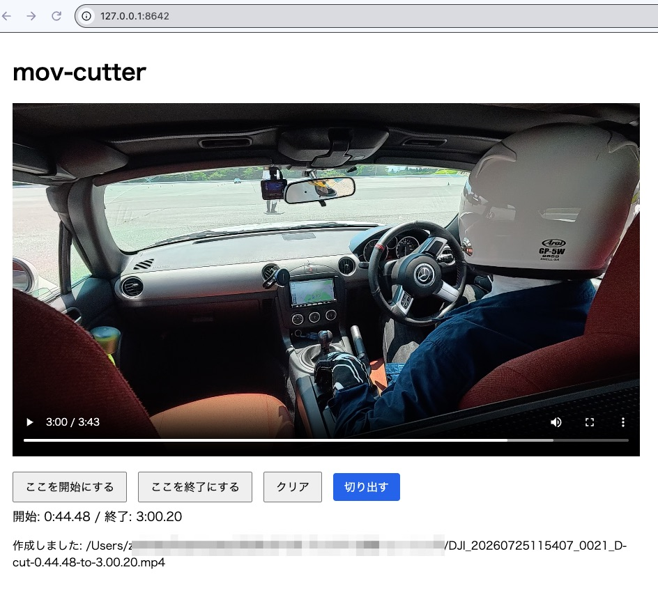

# mov-cutter

MP4動画を指定した範囲で切り出すツール。

再エンコードはしない（`ffmpeg -c copy`によるストリームコピー）。

CLIによる利用以外に、Web UIによる開始・終了点指定のサポート。



## ファイル説明

- `mov_cutter.py` : CLI。開始/終了時刻を文字列で指定して切り出す
- `mov_cutter_ui.py` : ブラウザUI。動画を再生しながら開始/終了位置をボタンで指定して切り出す（内部で`mov_cutter.py`のロジックを再利用）
- `mov_concat.py` : CLI。複数のMP4を再エンコードなしで順番に連結する

詳細な仕様は [spec.md](spec.md) を参照。

## 必要環境

- Python 3
- `ffmpeg`（PATHが通っていること）

```bash
brew install ffmpeg  # macOSの場合
```

### mise + uv で実行する場合

`mise.toml` に Python / uv とタスクを定義しています。

```bash
mise install
mise run cut -- -i input.mp4 -s 3:30 -e 4:59
mise run ui -- -i input.mp4
mise run concat -- -o concat.mp4 1.mp4 2.mp4
```

`ffmpeg` は別途インストールしてください。

## CLI: mov_cutter.py

```bash
python3 mov_cutter.py -i INPUT [-s START] [-e END] [-o OUTPUT]
```

| オプション | 必須 | 説明 |
|---|---|---|
| `-i`, `--input` | ○ | 入力MP4ファイルパス |
| `-s`, `--start` | - | 開始時刻。省略時は先頭から |
| `-e`, `--end` | - | 終了時刻。省略時は末尾まで |
| `-o`, `--output` | - | 出力ファイルパス。省略時は自動生成 |

時刻フォーマットは `M:SS`（例: `3:30` = 3分30秒）、`H:MM:SS`、秒数のみ、いずれも小数秒可（例: `3:30.5`）。

### 使用例

```bash
# 3:30〜4:59を切り出す -> input-cut-3.30-to-4.59.mp4
python3 mov_cutter.py -i input.mp4 -s 3:30 -e 4:59

# 出力ファイル名を指定
python3 mov_cutter.py -i input.mp4 -s 1:02:03 -e 1:05:00 -o clip.mp4

# 3:30から末尾まで -> input-cut-3.30-to-end.mp4
python3 mov_cutter.py -i input.mp4 -s 3:30

# 先頭から4:59まで -> input-cut-start-to-4.59.mp4
python3 mov_cutter.py -i input.mp4 -e 4:59
```

`-c copy`を使うため、開始位置は指定時刻の直前のキーフレームにスナップされます（数秒ずれることがあります）。

## CLI: mov_concat.py

複数のMP4を再エンコードなし（ストリームコピー）で指定順に連結します。

```bash
python3 mov_concat.py [-o OUTPUT] INPUT1 INPUT2 [INPUT3 ...]
```

| オプション | 必須 | 説明 |
|---|---|---|
| `INPUT...` | ○ | 入力MP4ファイルパス（2つ以上、指定順に連結） |
| `-o`, `--output` | - | 出力ファイルパス。省略時は `{先頭ファイル名}-concat.mp4` |

### 使用例

```bash
python3 mov_concat.py -o concat.mp4 1.mp4 2.mp4 3.mp4

# 出力ファイル名を省略 -> 1-concat.mp4
python3 mov_concat.py 1.mp4 2.mp4 3.mp4
```

`-c copy`を使うため、全入力ファイルのコーデック・解像度・フレームレート等のパラメータが一致している必要があります（不一致の場合は出力が壊れることがあります）。

## GUI: mov_cutter_ui.py

動画ファイルを別プレイヤーで確認しなくても、ブラウザ上で再生しながら開始/終了位置を指定できます。

```bash
python3 mov_cutter_ui.py -i INPUT [--port PORT]
```

| オプション | 必須 | 説明 |
|---|---|---|
| `-i`, `--input` | ○ | 入力MP4ファイルパス |
| `--port` | - | ローカルサーバーのポート番号（デフォルト: 8642） |

実行するとローカルHTTPサーバーが起動し、ブラウザが自動で開きます。

1. 動画を再生し、切り出したい開始位置で「ここを開始にする」を押す
2. 終了位置で「ここを終了にする」を押す
3. 「切り出す」を押すと同じディレクトリに切り出しファイルが生成される（ファイル名はCLI版と同じ命名規則）

`Ctrl+C` でサーバーを終了します。

**現時点ではMP4のみサポート**（`.mov`など他形式はブラウザでの再生互換性が低いため非対応）。巨大ファイル（30GB超など）もHTTP Rangeリクエストでチャンク配信するため問題なく扱えます。

## スコープ外

- 再エンコードによるフレーム精度の切り出し
- MP4以外のコンテナ形式
- 複数区間の一括切り出し
